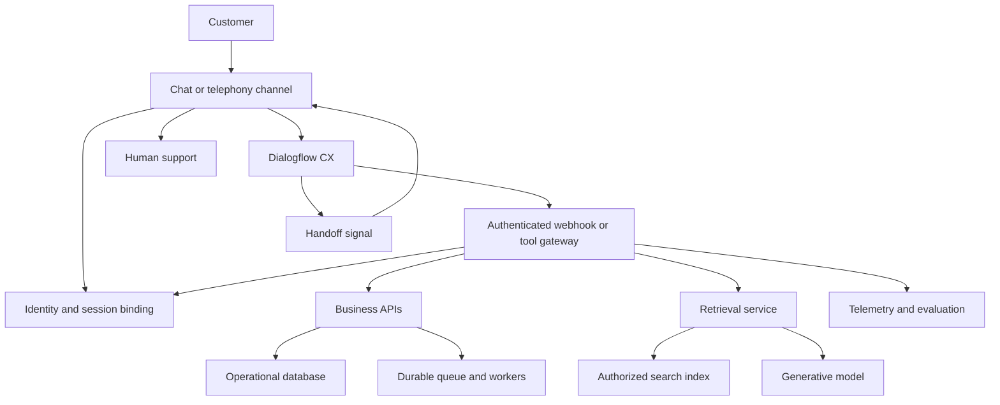

# Foundations: conversational AI system design with Dialogflow CX

This book prepares you to discuss systems for Google's Forward Deployed Engineer, Applied AI role. It uses Dialogflow CX for conversation management, with application services for identity, retrieval, model inference, enterprise integration, and durable business actions. The answers are proposed architectures, not assertions about the proprietary internals of the named products. Numerical targets are interview assumptions to challenge and measure.

Google's Applied AI role emphasizes moving customer conversational prototypes into production, integrating live systems, improving agent behavior, and managing security, latency, and reliability. Use those responsibilities to explain why your design choices matter. [Google Careers role description](https://www.google.com/about/careers/applications/jobs/results/106113082882695878-forward-deployed-engineer-iii-applied-ai)

## 1. Start with a customer journey

Describe an observable task: a verified customer checks an order and creates an eligible return. Establish channels, authentication, action permissions, data owners, traffic, freshness, languages, latency, escalation, and operating responsibility. A pleasant answer is not evidence that a return exists. Join conversation outcomes to authoritative business events.

Ask which failure is most costly. For an internal FAQ it may be unsupported information. For payments it may be a duplicate charge. For voice it may be a long silence. Those answers determine the control boundaries and reliability budget.

An initial interview scope can be deliberately small: order lookup, policy questions, and return creation through web chat, then explain voice changes. Add capabilities when the interviewer extends requirements.

## 2. Understand the CX building blocks

| Building block | Responsibility | Example |
|---|---|---|
| Agent | Container for the application | Retail Support |
| Flow | Conversation process | Returns |
| Page | State within a flow | Confirm Return |
| Intent | Meaning of an utterance | return.request |
| Entity | Structure for extracting a value | Return reason |
| Form | Required information for a page | Order and item |
| Session parameter | Temporary conversation context | Selected item |
| Route | Rule that fulfills or transitions | Eligible → Confirm |
| Event handler | Recovery for an event | Webhook timeout |
| Fulfillment | Responses and integration work | Lookup order |
| Webhook | Backend request | Authorized order API |
| Playbook | Generative task instructions | Explain policy |

CX pages describe conversation states. Routes and event handlers operate within their configured scope. Forms collect structured parameters, and session parameters can carry values between turns. Explicit route logic still depends on language understanding; test ambiguity and correction rather than assuming recognition is perfect. [Pages](https://docs.cloud.google.com/dialogflow/cx/docs/concept/page), [state handlers](https://docs.cloud.google.com/dialogflow/cx/docs/concept/handler), [parameters](https://docs.cloud.google.com/dialogflow/cx/docs/concept/parameter)

Google's current Conversational Agents console includes CX flow and generative capabilities. Console labels can differ from older tutorials; the book uses the CX concepts and API contracts. [Console documentation](https://docs.cloud.google.com/dialogflow/cx/docs/concept/console-conversational-agents)

## 3. Assign responsibility deliberately

CX owns the next conversational turn. The identity service owns verified principals. Domain services own facts, eligibility, and side effects. Retrieval supplies accessible evidence. A generative model interprets or explains within those boundaries. Evaluation determines whether the resulting system works.

Use flows when a required sequence matters, such as verification, item selection, confirmation, and submission. Use a playbook for flexible tasks with bounded tools. Use a generator for a defined transformation, such as summarizing a handoff. Use generative fallback for recovery from an unmatched utterance. Choose one conversational authority for a task so external orchestration does not maintain conflicting user-facing state.

Playbooks, data stores, generators, and generative fallback currently have exclusions from the CX SLA. Design a useful degraded experience around the capabilities you actually select; confirm current terms during a real deployment. [Playbooks](https://docs.cloud.google.com/dialogflow/cx/docs/concept/playbook), [data stores](https://docs.cloud.google.com/dialogflow/cx/docs/concept/data-store), [generators](https://docs.cloud.google.com/dialogflow/cx/docs/concept/generators), [fallback](https://docs.cloud.google.com/dialogflow/cx/docs/concept/generative-fallback)

## 4. Reference architecture



For a custom web channel, a trusted backend verifies login and binds a random CX session to a principal. A managed integration needs its own authentication design. The webhook resolves that binding, authorizes each protected request, and returns a small structured result. Never interpret a user-supplied customer ID as proof of ownership.

For classic product questions, the main product backend has its own architecture. CX can provide its support or natural-language interface; it does not replace collaborative editing, video delivery, or payment processing.

## 5. Temporary context versus durable state

Keep selected items and current pages in conversational context. Keep identity, authentication expiry, operations, audit records, and business outcomes in trusted stores. Avoid long-lived credentials in conversation parameters when an opaque server-side reference is sufficient.

CX sessions normally retain state for thirty minutes after the last request; the documented configurable TTL extends up to twenty-four hours. Restoring page and parameter state does not restore the handler call stack. A return must remain retrievable after conversation state expires. Serialize turns for one session, and use new session IDs for separate concurrent conversations. [CX sessions](https://docs.cloud.google.com/dialogflow/cx/docs/concept/session)

State the difference between service and user authorization: IAM can establish that CX may invoke a webhook; application policy establishes that the verified customer may access an order. Grant runtime callers and deployment principals different permissions. [CX access control](https://docs.cloud.google.com/dialogflow/cx/docs/concept/access-control)

## 6. The running transaction: create a return

The conversation path is Authenticate → Identify Order → Select Item → Collect Reason → Check Eligibility → Confirm → Submit → Result. Add correction, cancellation, status-checking, and escalation paths.

Confirmation refers to one concrete proposal. If the customer changes the item, quantity, address, or requested action, invalidate the proposal and confirm the new one. Scope confirmation intents to the confirmation page. Clear dependent parameters when an upstream choice changes.

The backend stores a proposal containing principal, order, item, quantity, policy version, expiry, and the exact action. It issues an opaque proposal ID and an operation ID. On submission it rechecks identity, eligibility, expiry, required confirmation evidence, and record versions. A uniqueness constraint prevents duplicate operations for the same proposal.

The operation follows CREATED → PROCESSING → SUCCEEDED, FAILED, or OUTCOME_UNKNOWN. Unknown means an external service might have executed despite a lost response. Query or reconcile that service before another side effect. Tell the customer the recorded status and reference; avoid inventing completion.

An outbox writes the operation and event in one local database transaction. A worker contacts the external system using its supported idempotency mechanism. There is no automatic atomic transaction spanning an arbitrary payment provider and your database. Consumers handle duplicates even when infrastructure offers useful delivery guarantees. [Cloud Tasks duplicate execution](https://docs.cloud.google.com/tasks/docs/common-pitfalls)

## 7. Webhook contracts and deadlines

A standard webhook carries a fulfillment tag and session information. Use allowlisted tags such as order.lookup, return.create_proposal, return.submit, and operation.status. The backend validates schemas, resolves identity, authorizes access, and returns typed domain outcomes. [Webhook request contract](https://docs.cloud.google.com/dialogflow/cx/docs/reference/rest/v3/WebhookRequest)

```json
{
  "fulfillmentInfo": {"tag": "order.lookup"},
  "sessionInfo": {
    "session": "projects/demo/locations/us-central1/agents/a/environments/prod/sessions/s42",
    "parameters": {"order_reference": "48271"}
  }
}
```

```json
{
  "sessionInfo": {"parameters": {"lookup_status": "FOUND"}},
  "fulfillmentResponse": {
    "messages": [{"text": {"text": ["Your order has shipped."]}}]
  }
}
```

Responses can update parameters and return messages or transitions. Expected ineligibility is a business outcome; invalid authentication and unavailable infrastructure are different failures. Keep those distinctions in telemetry. [Webhook response contract](https://docs.cloud.google.com/dialogflow/cx/docs/reference/rest/v3/WebhookResponse)

CX currently retries transient webhook failures once. Timeout applies per attempt, so cumulative waiting can approach twice that timeout. Set downstream deadlines within the conversational budget and make side effects idempotent. Long operations return a durable reference and continue asynchronously. [Webhook behavior](https://docs.cloud.google.com/dialogflow/cx/docs/concept/webhook)

Use authenticated invocation, least-privilege identities, and protected credentials. Test the actual network path and audience configuration in the customer's deployment. [Webhook implementation](https://docs.cloud.google.com/dialogflow/cx/docs/how/webhook)

## 8. Retrieval and generation

Policy explanation uses documents; individual eligibility uses the domain service. An ingestion pipeline parses approved sources, attaches permissions and version metadata, chunks them, creates embeddings, and publishes an index generation. A serving pipeline resolves identity, retrieves permitted evidence, optionally reranks, generates, and checks source support.

Store source IDs, document versions, chunk IDs, language, tenant, access policy, effective dates, and embedding version. Evaluate chunking against actual questions. Preserve tables and exceptions. Deletion and access revocation need propagation and cache invalidation.

Lexical retrieval helps with exact terms; semantic retrieval helps with paraphrase. Similarity scores are not truth probabilities. Empty, stale, conflicting, and unauthorized evidence are separate outcomes. A prompt alone cannot enforce document permissions or tool authorization.

Managed data stores and custom retrieval services are choices to evaluate against source support, identity mapping, freshness, ranking, traceability, and operational needs. Google reference architectures separate ingestion, serving, and quality evaluation; preserve those boundaries in your own design. [RAG architecture](https://docs.cloud.google.com/architecture/rag-capable-gen-ai-app-using-vertex-ai)

## 9. Tools, playbooks, and voice

Expose narrow tools with typed schemas: lookupOrder, searchPolicy, createReturnProposal, and getOperationStatus. Include unavailable, empty, and unauthorized examples. Treat tool outputs and retrieved text as untrusted content while backend controls enforce allowed actions.

CX supports OpenAPI and connector tools, along with function tools executed by client code. A function call requires the client to perform the work and submit the result. A backend can bridge to MCP when the customer requires it; the bridge still needs explicit identity, permissions, and contracts. [Playbook tools](https://docs.cloud.google.com/dialogflow/cx/docs/concept/playbook/tool)

Voice adds recognition, endpointing, playback, interruption, and telephone-transfer constraints. Use short prompts and confirmations. Evaluate the selected integration's support for barge-in and keypad input. Partial responses can flush queued messages through supported streaming interfaces; they are not arbitrary streaming from a synchronous webhook. [Speech settings](https://docs.cloud.google.com/dialogflow/cx/docs/concept/advanced-speech), [fulfillment behavior](https://docs.cloud.google.com/dialogflow/cx/docs/concept/fulfillment)

A CX handoff signal requires the channel or support integration to perform the transfer. Send a structured package with verified identity reference, completed steps, pending operation, reason, and language. A generated summary must not invent authoritative status.

## 10. Capacity and cost reasoning

Assume one million monthly conversations and eight turns each. Eight million turns over thirty days is about 3.1 turns per second on average. An assumed twentyfold peak is about 62 turns per second. If one quarter need custom inference, peak model traffic is about 15.5 requests per second.

Little's Law uses average time: at two seconds average model duration, approximately 31 requests are in service. Do not substitute p95 latency and call the result average concurrency. Validate burst shape, tokens per minute, search throughput, customer API limits, database connections, and escalation capacity.

Cloud Run concurrency and instance limits should protect downstream dependencies. CPU, memory, connection limits, and model quotas may become bottlenecks at different stages. [Cloud Run concurrency](https://docs.cloud.google.com/run/docs/about-concurrency), [Dialogflow quotas](https://docs.cloud.google.com/dialogflow/quotas)

Estimate conversation, custom inference, index, compute, storage, telemetry, integration, and network costs. Use actual billing categories: hybrid CX features can change billing, and included generation should not be charged twice in an estimate. [Conversational Agents pricing](https://cloud.google.com/products/conversational-agents/pricing)

Cache only with appropriate authorization and version keys. Compare optimizations using cost per successful task, not cost per response.

## 11. Evaluation and release discipline

Test conversation paths, API contracts, AI quality, and business outcomes independently. CX test cases check conversation expectations; backend tests check ownership and action invariants. Generative evaluations measure retrieval, groundedness, useful abstention, and tool selection. Human review calibrates model-based judges. [CX test cases](https://docs.cloud.google.com/dialogflow/cx/docs/concept/test-case), [playbook evaluation](https://docs.cloud.google.com/dialogflow/cx/docs/concept/playbook/evaluation)

Track task success, action correctness, recovery, successful handoff, latency, and cost per completed task. A conversation that avoids a human may still fail. Keep held-out cases, repeated generative trials, and regression cases drawn from incidents.

Record flow/playbook/tool versions, webhook revision, model configuration, prompt version, schema version, index generation, and evaluation dataset in a release manifest. Use custom production environments and environment-specific webhooks. Active sessions can be affected by incompatible version changes, so design migration or cohort routing. [Versions and environments](https://docs.cloud.google.com/dialogflow/cx/docs/concept/version)

Logs and traces connect conversation, turn, release, tool, and operation. Configure redaction, retention, and regional routing across every component rather than assuming one setting covers all systems. [Security settings](https://docs.cloud.google.com/dialogflow/cx/docs/concept/security-settings), [logging](https://docs.cloud.google.com/dialogflow/cx/docs/concept/logging)

## 12. How to use the retained design answers

Each answer establishes scope, proposes a request path and state model, examines failure/security/scale, justifies a trade-off, and answers a follow-up. Treat it as a defensible starting point. Change the assumptions and explain how the architecture changes.

For a forty-five-minute rehearsal, spend five minutes clarifying, five quantifying, eight drawing, twelve on core data/control paths, eight on failures and evaluation, and the remainder on follow-ups. Explain ownership and causality: this operation record exists because requests can be repeated; this ACL check exists because indexed permissions can lag; this degraded path exists because generation can fail.

The detailed drive-through, Noctal, and market-assistant chapters connect these patterns to the requested use cases. The 30 answers completed before the scope changed are retained as an appendix; the question bank was not expanded further.
